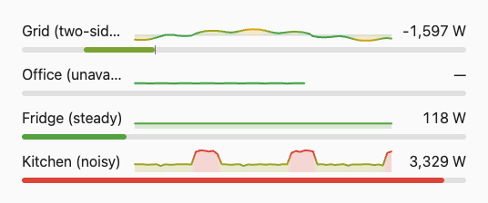

# Constant Powermeter Card

A Home Assistant Lovelace card that shows several power meters in one panel. Each meter has its own thresholds, a live value, and a sparkline, a bar, or both. It uses `ha-card` and your theme variables, so it looks like the built-in cards in any light or dark theme.



Features:

- Several meters per card, each with its own `min`, `max`, thresholds, name and unit.
- Sparkline and bar, chosen per panel or per meter. The sparkline is colored by level along the line.
- Level colors are set once per panel and shared by every meter.
- Two-sided meters for values that go negative (grid, solar, battery).
- Combined charts above the rows: stacked areas, lines, a donut, or a stacked chart and a donut together. They show how the load splits across your meters, with an optional "Untracked" remainder.
- Click a meter to open its more-info dialog, or navigate, or open a URL.
- A visual editor for everything, including the thresholds of each meter. YAML is optional.
- One history subscription per card, not one per meter.

## Installation

### HACS (custom repository)

1. In Home Assistant, open HACS and choose the three-dot menu, then **Custom repositories**.
2. Add `https://github.com/uded/constant-powermeter-card` with the category **Dashboard** (called **Lovelace** in older HACS versions).
3. Find **Constant Powermeter Card** in HACS and install it.
4. Reload the browser. HACS registers the resource for you.

### Manual

1. Download `constant-powermeter-card.js` from the `dist/` folder (or a release) and copy it to `<config>/www/`.
2. Go to **Settings, Dashboards, three-dot menu, Resources** and add `/local/constant-powermeter-card.js` as a **JavaScript module**.
3. Reload the browser.

## Usage

Add the card from the card picker (search for "Constant Powermeter") and use the visual editor, or write YAML.

### Full example

Every option, with its default where there is one:

```yaml
type: custom:constant-powermeter-card
title: Per-room power # optional
display: [sparkline, bar] # panel default; one or both
hours: 1 # sparkline window, 0.25 to 24, default 1
sparkline_scale: fixed # fixed (min..max) | auto (data min..max)
colors: # shared by every meter in the panel
  normal: var(--success-color) # default
  warning: var(--warning-color)
  critical: var(--error-color)
blend: true # interpolate between levels; false = step
chart: [stacked, donut] # stacked | lines | donut, or a list; default: no chart
rows: true # false hides the meter rows (needs a chart)
total: sensor.house_load # optional whole-house load, enables "Untracked"
meters:
  - entity: sensor.kitchen_power
    color: '#4e79a7' # optional chart color, default: next palette color
    name: Kitchen # default: friendly_name
    unit: W # default: unit_of_measurement, else none
    precision: 0 # default: entity display precision, else 0
    min: 0 # default 0
    max: 3500 # default 5000
    normal: 500 # default min + 20% of range
    warning: 2000 # default min + 60% of range
    critical: 3000 # default max
    display: [bar] # optional override of the panel default
    tap_action:
      action: more-info # default
  - entity: sensor.grid_power
    name: Grid
    min: -3000 # min below 0 makes the meter two-sided
    max: 7000
    normal: 1000 # thresholds apply to the absolute value
    warning: 3000
    critical: 5000
    tap_action:
      action: navigate
      navigation_path: /energy
  - sensor.office_power # bare entity id: all defaults
```

### Options

Panel options:

| Option            | Default                | Description                                                       |
| ----------------- | ---------------------- | ----------------------------------------------------------------- |
| `title`           | none                   | Optional header above the rows.                                   |
| `display`         | `[sparkline, bar]`     | One or both of `sparkline` and `bar`. Unknown values are ignored. |
| `hours`           | `1`                    | Sparkline window in hours, 0.25 to 24.                            |
| `sparkline_scale` | `fixed`                | `fixed` uses the meter's `min..max`, `auto` uses the data range.  |
| `colors.normal`   | `var(--success-color)` | Any CSS color: named, hex, `rgb()`, `hsl()` or `var()`.           |
| `colors.warning`  | `var(--warning-color)` |                                                                   |
| `colors.critical` | `var(--error-color)`   |                                                                   |
| `blend`           | `true`                 | Blend between level colors. `false` switches colors in steps.     |
| `chart`           | none                   | `stacked`, `lines` or `donut`, or a list. See "Combined charts".  |
| `rows`            | `true`                 | `false` hides the meter rows and shows a legend. Needs a chart.   |
| `total`           | none                   | Entity id of the whole-house load. Enables "Untracked".           |
| `meters`          | required               | At least one entry. Each is an entity id or an object.            |

Meter options:

| Option       | Default                          | Description                                             |
| ------------ | -------------------------------- | ------------------------------------------------------- |
| `entity`     | required                         | Entity id.                                              |
| `name`       | `friendly_name`                  | Row label. Long names are cut with an ellipsis.         |
| `unit`       | `unit_of_measurement`, else none | Display label only. Rows do not convert W, kW or MW.    |
| `precision`  | entity display precision, else 0 | Decimals shown.                                         |
| `min`        | `0`                              | Bottom of the scale. Below 0 makes the meter two-sided. |
| `max`        | `5000`                           | Top of the scale.                                       |
| `normal`     | `min` + 20% of the range         | Up to this value the normal color is used.              |
| `warning`    | `min` + 60% of the range         | Warning color is reached here.                          |
| `critical`   | `max`                            | From here the critical color is used.                   |
| `display`    | panel `display`                  | Override the panel default for this meter.              |
| `tap_action` | `more-info`                      | What a click does. See below.                           |
| `color`      | next palette color               | Chart color for this meter. Any CSS color.              |

Notes:

- Thresholds must satisfy `normal <= warning <= critical`. A config that breaks this still renders, the values are sorted, and the editor shows an error on that meter.
- Derived threshold defaults are not written into the config, so they follow `min` and `max` when those change. A derived default never passes a threshold you set: with only `critical: 2500` on a 0 to 5000 meter, `warning` becomes 2500 instead of 3000.
- Values are used exactly as the entity reports them. Thresholds, history and the bar all use the same unit.
- A state that is `unavailable`, `unknown`, empty or not a number shows `—`, hides the bar fill, and leaves a gap in the sparkline.

### How level colors work

The level comes from the meter's own thresholds. At or below `normal` the normal color is used. At or above `critical` the critical color is used. In between, the color is a blend of the two neighbouring levels when `blend: true`, or the lower level's color when `blend: false`. The value text keeps the theme's primary text color so it stays readable. Only the bar fill and the sparkline use the level color.

The three colors accept any CSS color: a name (`blue`), hex (`#43a047`), `rgb()`, `hsl()`, or a theme variable such as `var(--success-color)`, with or without an inline fallback (`var(--my-color, #abc)`). A value the browser cannot read as a color uses the level's built-in default.

### Two-sided meters

Some meters go below zero, such as grid export, battery discharge or a solar inverter's night draw. There is no extra option: a meter is two-sided when its `min` is below 0. Meters with `min >= 0` behave as plain consumption meters.

```yaml
- entity: sensor.grid_power
  name: Grid
  min: -3000
  max: 7000 # zero sits at 30% of the track
  normal: 1000
  warning: 3000
  critical: 5000
```

On a two-sided meter:

- The bar fill starts at the zero point and grows toward the value. A thin tick marks zero.
- The sparkline draws a faint zero line, and the area fill runs from the line to zero. With `sparkline_scale: auto` the range always includes zero.
- Thresholds apply to the absolute value, so 3 kW of export is as "hot" as 3 kW of import. Thresholds must be `>= 0`. The editor marks a negative threshold as an error.
- Each sparkline bucket plots the sample with the largest absolute value, so a short export spike is as visible as an import spike.
- Threshold defaults are derived from `max(|min|, max)` instead of the range.

### Combined charts

Add `chart` to see how the load splits across your meters, above the rows. Cards without `chart` look and behave exactly as before.

```yaml
type: custom:constant-powermeter-card
title: Where the power goes
chart: [stacked, donut]
total: sensor.house_load # whole-house load, not grid import
hours: 6
meters:
  - entity: sensor.kitchen_power
    color: '#4e79a7'
  - entity: sensor.ev_charger_power
  - entity: sensor.heat_pump_power
  - entity: sensor.grid_power
    min: -3000 # two-sided meters work in a stack too
    max: 7000
```

Chart types:

| Value     | What it shows                                                                                    |
| --------- | ------------------------------------------------------------------------------------------------ |
| `stacked` | Stacked areas over time, one layer per meter, in config order. Negative values stack below zero. |
| `lines`   | One line per meter over time on a shared scale.                                                  |
| `donut`   | The current split, from live values. It needs no history.                                        |

`chart` takes one value or a list. Use `[stacked, donut]` for both: the donut sits to the right of the time chart, and moves below it when the card is narrower than about 360 px. Only one time chart can be shown. If you list both `stacked` and `lines`, the first one wins and the editor shows a warning. Unknown values are ignored.

How the charts are built:

- The time charts use the card's `hours`, with the same history subscription as the sparklines. No extra requests.
- `stacked` plots the average per time step, so the layers add up to the real average load. `lines` plots the peak per step, like the sparklines, so each line keeps its short spikes.
- The donut uses live values. Meters that read 0, go negative, are unavailable or are not a number are left out. If nothing is left, it shows an empty ring and `—`. The center shows the total, or the sum of the slices when there is no `total`.
- Layers and slices keep the order of `meters`, so they do not reshuffle when values change.

#### Rows, legend and shares

With a chart on, each row gets a small color square before the name and a share after the value, for example `1,240 W · 13%`. The share is the meter's live value divided by `total` when it is set, otherwise by the sum of the positive meters. The sum is also used when `total` is unavailable or 0 or less. Negative and unavailable meters show no share, and no meter does when the denominator is zero.

Set `rows: false` to show only the chart. A compact legend (a color square and the name per meter, plus "Untracked" when `total` is set) then appears under the chart. `rows: false` without any chart is ignored, because the card must show something.

#### Total and Untracked

Set `total` to an entity that reports your whole-house load. The difference between the total and the sum of your meters is shown as an **Untracked** layer, line or slice, in grey and always last. It never goes below zero.

Use a whole-house **load** sensor for `total`, not grid import. When you have solar or a battery, grid import is smaller than what the house actually uses, so Untracked would be wrong. Negative meters (export, discharge) are ignored for Untracked and for shares: Untracked is `total` minus the sum of the positive meters.

`total` does not add a row. List it under `meters` as well if you want one. Without `chart` it has no effect. If the total is unavailable, the donut drops the Untracked slice and shows the sum of the other slices until it reports again.

#### Colors

Without `color`, each meter takes the next color from Home Assistant's own graph colors (`--graph-color-1` and up), so the chart matches the history graphs. If your theme does not define them, a built-in set of ten colors is used. A meter keeps its color by its position in `meters`. Set `color` on a meter (any CSS color) to pick your own. Level colors still drive the row's bar and sparkline.

#### Units

For the combined charts, shares and Untracked, `W`, `kW` and `MW` are converted to watts before adding, so a `kW` meter and a `W` meter can share a chart. Any other unit is used as reported. If the meters use units that cannot be converted to each other, the editor warns that the chart may be misleading. The rows keep showing each meter's own unit. The label at the top left of the chart (the top of the scale) and the number in the donut center are shown in W when the first meter reports `W`, `kW` or `MW`. Otherwise they use the first meter's own unit.

### Click on a meter

Clicking a meter row opens the more-info dialog for its entity (history, attributes, settings), the same dialog the built-in entity cards open. Set `tap_action` on a meter to change that:

```yaml
tap_action:
  action: more-info # default
  # action: navigate
  # navigation_path: /energy
  # action: url
  # url_path: https://example.com
  # action: none
```

| Action      | Extra field       | Effect                                     |
| ----------- | ----------------- | ------------------------------------------ |
| `more-info` | none              | Opens the more-info dialog for the entity. |
| `navigate`  | `navigation_path` | Navigates to a dashboard path.             |
| `url`       | `url_path`        | Opens a URL.                               |
| `none`      | none              | Does nothing. The row is not focusable.    |

Rows are keyboard accessible: they have `role="button"` and `tabindex="0"`, and Enter or Space trigger the action. `perform-action`, `hold_action` and `double_tap_action` are not supported yet. In the editor preview, clicks do nothing, so you do not open dialogs while editing.

### Visual editor

Everything above can be set in the editor, with no YAML needed:

- **Panel:** title, display (sparkline and bar), window in hours, sparkline scale, the three level colors, and the blend toggle.
- **Charts:** a **Chart** multi-select (Stacked, Lines, Donut), a **Show rows** toggle, and an optional **Total meter** entity picker. The editor warns when both Stacked and Lines are selected, or when the meters use units that cannot be converted to each other.
- **Meters:** one expandable section per meter, with entity, name, unit, precision, min, max, the three thresholds, display override, a tap action (More info, Navigate, URL, None) and a chart **Color** with a swatch (the helper text shows the default palette color). Navigate and URL show a path field.
- **Threshold preview strip:** a thin bar from `min` to `max` (from 0 to `max(|min|, max)` on a two-sided meter, since its thresholds apply to the absolute value) painted with the three level bands in the panel colors. It updates as you type, so a wrong value is visible before saving.
- **Validation:** thresholds that break `normal <= warning <= critical`, or a negative threshold on a two-sided meter, are marked with a short message.
- **Reordering:** move meters with the up and down buttons, delete with the bin, add with **Add meter**.
- Picking an entity fills the name and unit placeholders from its attributes. Bare entity-id entries are expanded to objects when edited in the UI.

## Development

Requirements: Node.js and [go-task](https://taskfile.dev).

```sh
npm ci          # install dependencies
task check      # eslint, prettier, tsc and vitest
task build      # build dist/constant-powermeter-card.js
task dev        # watch build and serve the dev harness at http://localhost:5173/dev/index.html
```

The dev harness in `dev/index.html` runs the built card against a mock `hass` and a mock `connection`. It replays an hour of fake history, pushes a new value every 5 seconds, and has a light and dark toggle. It also has a combined-chart card (stacked areas and a donut, with a total above the sum of the meters and a two-sided meter in the stack) and a 300 px wide copy of it to check how the donut wraps. It needs no Home Assistant instance.

`dist/constant-powermeter-card.js` is committed, because HACS installs it straight from the repository. CI fails if the committed bundle is out of date, so run `task build` and commit `dist/` with your change.

## Credits

Inspired by the linear bar card of [Lirum-Labs/ha-power-gauge](https://github.com/Lirum-Labs/ha-power-gauge). This card is a fresh rewrite and does not contain code from that project.

## License

[MIT](LICENSE)
